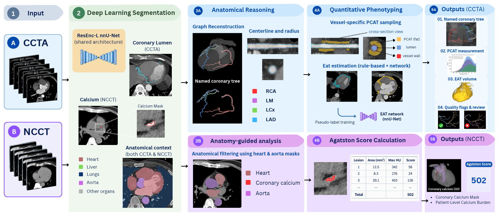
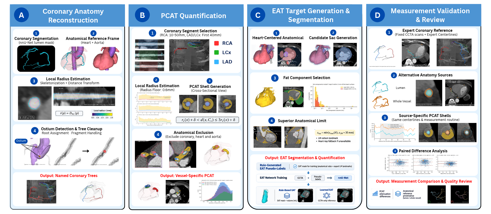

<div align="center">

# An Automated Framework Integrating Deep Learning and Anatomical Reasoning for Cardiac Phenotyping From CCTA

**Hien M. Tran, Hien T. T. Pham, Tan D. Le, Hieu X. Nguyen, and Anh P. T. Mai**

Source code, run configurations and saved evaluation outputs for the manuscript prepared for *IEEE Journal of Biomedical and Health Informatics*

[Overview](#overview) · [Results](#results) · [Provenance](#provenance-of-every-number) · [Reproduce](#reproduce) · [Data](#data-availability) · [Model weights](#model-weights) · [Citation](#citation)

</div>

## Abstract

Coronary computed tomography angiography (CCTA) depicts anatomy and cardiac fat, but segmentation alone does not provide anatomically consistent measurements. We propose an automated framework integrating deep learning and anatomical reasoning for quantitative cardiac phenotyping. Its anatomical measurement construction uses graph geometry, branch identity and surrounding structures to define vessel-specific pericoronary adipose tissue (PCAT) sampling and a surrogate epicardial adipose tissue (EAT) compartment. The latter also generates training targets without expert pericardium contours. A companion module quantifies calcium on non-contrast CT. Component-wise benchmarking used five public datasets: ImageCAS, ImageCAS-X, COCA, Visual Lab and MultiD4CAD. The original saved outputs yield mean Dice 0.9133 and clDice 0.9402 for coronary lumen segmentation with post-processing on ImageCAS-X test-160. On ImageCAS, Single ResEnc-L achieves mean Dice 0.8350 across the official four splits; on Split 1, the saved three-member ensemble achieves 0.8437 and a pre-registered four-member ensemble, evaluated in a single test access in November 2026, achieves 0.8464 (95% CI 0.8409–0.8518). An 800-scan paired analysis identified PCAT attenuation differences of 3.0–4.2 HU between whole-vessel and lumen references with fixed expert centrelines. External EAT volume correlation reached 0.944, with Dice 0.800 after matching the reference slice range and fat window. Explicit anatomical rules and quality flags make the resulting measurements inspectable.

## Overview

<p align="center">
  
</p>

**Fig. 1.** Framework overview. (1) Inputs: a CCTA volume (A) and an optional non-contrast CT (B). (2) Deep-learning segmentation with a shared ResEnc-L nnU-Net architecture: coronary lumen on CCTA, calcium on NCCT and anatomical context (heart, aorta, lungs, liver) on both. (3A) Anatomical reasoning: skeleton-graph reconstruction, centreline and radius estimation and the named coronary tree; (3B) anatomy-guided filtering of calcium candidates with the heart and aorta masks. (4A) Quantitative phenotyping: vessel-specific PCAT sampling and EAT estimation, rule-based and by a network trained on rule-generated pseudo-labels; (4B) Agatston score calculation. (5A) CCTA outputs: named tree, PCAT measurement, EAT volume and quality flags for review; (5B) NCCT outputs: coronary calcium mask and patient-level calcium burden.

<p align="center">
  
</p>

**Fig. 2.** Anatomical reasoning and measurement construction. (A) Coronary anatomy reconstruction: lumen segmentation, anatomical reference frame (heart and aorta), local radius estimation by skeletonisation and distance transform, ostium detection and tree clean-up, giving named coronary trees. (B) PCAT quantification: proximal segment selection (RCA 10–50 mm; LAD and LCx first 40 mm after the left main), local radius with a 0.6 mm floor, a shell from r + δ to 3r + δ around the centreline, and anatomical exclusion of coronary, heart and aorta voxels. (C) EAT target generation and segmentation: heart-centred anatomical frame, candidate sac, fat-component selection, and a superior limit at the lower of the heart top and 35 mm above the expert left-main landmark; the rule output trains the EAT network, which provides a CCTA-only inference path. (D) Measurement validation and review: expert coronary reference with fixed scans and centrelines, alternative anatomy sources (lumen, whole vessel), source-specific PCAT shells under the same centrelines and routine, and paired difference analysis with provenance and quality flags.

### Repository map

| Path | Contents |
|---|---|
| [`src/coronary_tree/`](src/coronary_tree) | Package: [`data`](src/coronary_tree/data) (nnU-Net dataset preparation on the official splits), [`evaluate`](src/coronary_tree/evaluate) (per-case metrics `coronary-evaluate`, post-processing `coronary-postprocess`, export contract), [`tree`](src/coronary_tree/tree) (skeleton graph, ostia, tree construction, branch naming), [`pcat`](src/coronary_tree/pcat) (PCAT shell sampling and expert comparison) |
| [`scripts/`](scripts) | Experiment and analysis scripts; [`scripts/training`](scripts/training) (nnU-Net recipes), [`scripts/calcium`](scripts/calcium) (companion calcium module), [`scripts/rerun_2026_11`](scripts/rerun_2026_11) (November 2026 replication and sixth test access) |
| [`configs/`](configs) | Official ImageCAS split manifest, ImageCAS-X file lists, [checkpoint table](configs/model_checkpoints.csv), environment locks, [pre-registrations](configs/prereg_2026_11) |
| [`results/`](results) | Saved scalar outputs, one folder per dataset ([ImageCAS](results/imagecas), [ImageCAS-X](results/imagecas-x), [COCA](results/coca), [MultiD4CAD](results/multid4cad), [Visual Lab](results/visual-lab)), plus the [release summary](results/release_segmentation_summary.csv), the [provenance record](results/release_segmentation_provenance.json) and the [paper-value audit](results/paper_values.csv) |
| [`docs/figures/`](docs/figures) | Fig. 1 and Fig. 2 |
| [`tests/`](tests) | 102 tests; CI runs Ruff, shfmt, pytest and the export validators ([workflow](.github/workflows/tests.yml)) |

| Paper section | Code |
|---|---|
| III-B Coronary segmentation and post-processing | [`src/coronary_tree/data`](src/coronary_tree/data), [`src/coronary_tree/evaluate`](src/coronary_tree/evaluate), [`scripts/training`](scripts/training), [`scripts/imagecas_ensemble_access3.py`](scripts/imagecas_ensemble_access3.py), [`scripts/rerun_2026_11/final6_pool.py`](scripts/rerun_2026_11/final6_pool.py) |
| III-C Tree reconstruction and branch identification | [`src/coronary_tree/tree`](src/coronary_tree/tree), [`scripts/branch_name_check_imagecasx.py`](scripts/branch_name_check_imagecasx.py) |
| III-D PCAT quantification | [`src/coronary_tree/pcat`](src/coronary_tree/pcat), [`scripts/pcat_auto_vs_expert.py`](scripts/pcat_auto_vs_expert.py), [`scripts/pcat_expert_reference.py`](scripts/pcat_expert_reference.py), [`scripts/pcat_expert_wholevessel.py`](scripts/pcat_expert_wholevessel.py), [`scripts/pcat_shell_sensitivity.py`](scripts/pcat_shell_sensitivity.py) |
| III-E EAT without pericardium contours | [`scripts/eat_rule_based.py`](scripts/eat_rule_based.py), [`scripts/training/eat_train.sh`](scripts/training/eat_train.sh), [`scripts/score_eat_predictions.py`](scripts/score_eat_predictions.py) |
| III-F Companion calcium scoring | [`scripts/calcium`](scripts/calcium) |
| IV External evaluation | [`scripts/multid4cad_eval.py`](scripts/multid4cad_eval.py), [`scripts/multid4cad_pat_report.py`](scripts/multid4cad_pat_report.py), [`scripts/visuallab_eat_eval.py`](scripts/visuallab_eat_eval.py) |

## Results

Every value below is recomputed from the files in [`results/`](results); the last column of each table names the file that holds it. Segmentation values are means over cases with 95% percentile-bootstrap confidence intervals (10 000 resamples). In November 2026 the archived checkpoints were re-executed on an NVIDIA A100 (nnU-Net v2.8.1, PyTorch 2.8.0) and reproduced every saved per-case score (|ΔDice| ≤ 5 × 10⁻⁵, [replication files](results/imagecas/replication)); one pre-registered Split-1 configuration was then evaluated in a single additional test access.

### Coronary segmentation

**ImageCAS, whole-vessel labels (official splits, 250 test cases each; Table III of the paper)**

| Model | Scope | n | Dice (%) | 95% CI | clDice (%) | HD95 (mm) | e<sub>β0</sub> | Source |
|---|---|---:|---:|---|---:|---:|---:|---|
| Single ResEnc-L | Splits 1–4 | 1000 | 83.50 | ± 0.66 SD across splits | 89.24 | 8.92 | 2.89 | [`foursplit_summary.json`](results/imagecas/foursplit_summary.json) |
| Three-member ensemble | Split 1 only, test access 3 | 250 | 84.37 | 83.82–84.90 | 89.81 | 8.37 | 2.86 | [`test_access_3_result.json`](results/imagecas/test_access_3_result.json) |
| Four-member ensemble (2026-11) | Split 1 only, test access 6 | 250 | **84.64** | 84.09–85.18 | **90.02** | **7.89** | **2.52** | [`test_access_6_result.json`](results/imagecas/test_access_6_result.json) |

**ImageCAS-X, lumen labels (official test-160; Table IV of the paper)**

| Model | Dice (%) | 95% CI | clDice (%) | HD95 (mm) | e<sub>β0</sub> | Source |
|---|---:|---|---:|---:|---:|---|
| M1 (ResEnc-L lumen model) | 91.01 | 90.60–91.40 | 93.90 | 2.39 | 3.26 | [`xbench_ours_result.json`](results/imagecas-x/xbench_ours_result.json), [authors' evaluator](results/imagecas-x/imagecasx_evaluate_py_results.json) |
| M1 + post-processing | **91.33** | 90.93–91.72 | **94.02** | 2.47 | **0.96** | [`lumen_access2_test_result.json`](results/imagecas-x/lumen_access2_test_result.json), [authors' evaluator](results/imagecas-x/imagecasx_evaluate_py_results_access2.json) |

Single ResEnc-L per split: 83.96, 84.13, 82.71 and 83.21 ([per-split files](results/imagecas)). The three-member ensemble combines the baseline U-Net continued to 500 epochs, ResEnc-L and ResEnc-L fine-tuned for 250 epochs; the four-member ensemble adds a ResEnc-L trained for 1000 epochs (equal weights, sliding-window step 0.25, no test-time augmentation, threshold 0.5). Its composition was chosen on the 50 Split-1 validation cases among seven pre-specified candidates (validation Dice 84.69 against 84.39 for three members; [choice record](results/imagecas/test_access_6_choice.json), [pre-registration](configs/prereg_2026_11/PREREG_final_split1.txt)) and the test set was accessed once. Over the same 250 cases the paired difference to the three-member ensemble is +0.27 Dice points (95% CI +0.18 to +0.36), +0.21 clDice points and −0.48 mm HD95, with centreline coverage 0.27 points lower. Three other configurations were discarded on validation without any test access: the 1000-epoch model alone (83.71 against 83.90 for the 250-epoch model), a Skeleton Recall loss variant (83.67) and validation-selected post-processing of the three-member ensemble (no gain); their records are in [`split1_validation_experiments`](results/imagecas/split1_validation_experiments). The ensemble result is specific to Split 1, and the DiffCAS four-split mean of 84.59 lies inside its confidence interval, so the two are comparable rather than ordered. No ensemble outputs exist for Splits 2–4.

ImageCAS-X post-processing (hysteresis τ<sub>l</sub> = 0.3, components ≥ 10 mm³) was selected on validation-80 ([`validation_selection.csv`](results/imagecas-x/validation_selection.csv): Dice 91.61, e<sub>β0</sub> 0.90, against 91.32 for unprocessed M1). The published CAS-Net value of 91.20 lies inside the post-processed interval. ImageCAS-X HD95 values come from the dataset authors' evaluator; the local evaluator gives 2.40 and 2.48 mm. The earlier printed values 84.90, 91.40 and 91.72 were the stored upper confidence bounds of these rows, not means.

### Coronary tree and branch identification (Table V-A)

| Evaluation | n | Result | Source |
|---|---:|---|---|
| Both ostia found, whole-vessel out-of-sample trees | 800 | 799 / 800 | [`oos_tree_summary_800.csv`](results/imagecas-x/oos_tree_summary_800.csv) |
| All four main vessels named correctly | 800 | 697 / 800 (87.1%); 89.5% of QC-complete trees, 51.0% of flagged trees | [`branch_names_800_per_case.csv`](results/imagecas-x/branch_names_800_per_case.csv) |
| Side-branch edge precision, named branches with ≥ 10 edges | 800 | 29–57% | [`branch_names_800_edges.csv`](results/imagecas-x/branch_names_800_edges.csv) |
| All four main vessels correct, lumen model M1 | 160 | 83.1% | [`branch_names_lumen_160_per_case.csv`](results/imagecas-x/branch_names_lumen_160_per_case.csv) |
| QC-complete candidate trees, lumen model M1 | 160 | 149 / 160 (93.1%); median 5 components | [`lumen_tree_summary_160.csv`](results/imagecas-x/lumen_tree_summary_160.csv) |

### PCAT attenuation (Table V-B, Fig. 4)

Automatic anatomy against expert centrelines and masks, same PCAT routine. Bias is automatic minus expert, in HU; LoA are Bland–Altman limits of agreement.

| Comparison | Vessel | Pairs | ICC(2,1) | Bias (HU) | LoA (HU) | Source |
|---|---|---:|---:|---:|---|---|
| Lumen model M1, test-160 | RCA | 158 | 0.97 | +0.7 | −2.6 to +4.1 | [`pcat_lumen_vs_expert_160.json`](results/imagecas-x/pcat_lumen_vs_expert_160.json) |
| | LAD | 154 | 0.93 | +0.2 | −5.3 to +5.7 | |
| | LCx | 154 | 0.95 | −0.4 | −4.9 to +4.1 | |
| Whole-vessel models, out-of-sample 800 | RCA | 784 | 0.84 | −2.6 | −9.5 to +4.3 | [`pcat_auto_vs_expert_800.json`](results/imagecas-x/pcat_auto_vs_expert_800.json) |
| | LAD | 788 | 0.76 | −4.3 | −10.6 to +2.0 | |
| | LCx | 788 | 0.75 | −4.3 | −11.2 to +2.5 | |

Paired expert-mask control (800 scans; scans, expert centrelines and measurement code held fixed, only the mask source replaced): whole-vessel minus lumen attenuation −3.04 HU (RCA), −4.24 HU (LAD) and −3.78 HU (LCx) ([`pcat_expert_mask_control_800.json`](results/imagecas-x/pcat_expert_mask_control_800.json)). The difference stays negative under all three shell definitions tested post hoc ([`shell_sensitivity_800/summary.json`](results/imagecas-x/shell_sensitivity_800/summary.json)); annotation-source differences remain alongside convention.

### EAT (Table V-C)

| Reference | n | Dice | Volume agreement | Source |
|---|---:|---|---|---|
| MultiD4CAD, rule-based EAT | 108 | 0.725 within the reference slice range; 0.800 after matching the fat window | r 0.944; bias −78 mL (LoA −203 to +47) | [`multid4cad_summary.json`](results/multid4cad/multid4cad_summary.json) |
| MultiD4CAD, learned EAT network | 108 | 0.715 | r 0.696; bias −46 mL | [`multid4cad_summary.json`](results/multid4cad/multid4cad_summary.json) |
| Visual Lab, rule-based EAT | 10 | 0.664 (0.705 ignoring drawn-line pixels) | sensitivity 0.83, PPV 0.57 | [`visuallab_default_per_patient.csv`](results/visual-lab/visuallab_default_per_patient.csv) |
| ImageCAS-X test, network against the rule it was trained on | 160 | 0.857 | r 0.997; bias −4 mL | [`eat_test_result.json`](results/imagecas-x/eat_test_result.json) |

On MultiD4CAD the left-main landmark was found in 98 of 108 evaluable scans, the software sac covered 75% of the reference, and 16% of reference voxels lay outside the fat window.

### Calcium on non-contrast CT (Table V-D, COCA)

| Cohort | n | 3D Dice | Agatston agreement | Lesion detection | Source |
|---|---:|---|---|---|---|
| Gated, patient-held-out test | 116 | 0.881 (65 reference-positive scans) | weighted κ 0.854; score ICC 0.946; bias +34 (LoA −322 to +391) | sensitivity 0.903, PPV 0.873 | [`cacseg_heldout_result.json`](results/coca/cacseg_heldout_result.json) |
| Non-gated | 210 | – | weighted κ 0.573; score ICC 0.820 | – | [`cacseg_nongated_c4_result.json`](results/coca/cacseg_nongated_c4_result.json) |

Validation ablations of the calcium model (heart crop, ResEnc-L preset, candidate channel) are in [`validation_ablations.csv`](results/coca/validation_ablations.csv).

### Whole-framework external check (MultiD4CAD, 118 CCTA scans)

With the unchanged lumen model M1: median 13 connected components per scan (5 on ImageCAS-X test-160), both ostia found in 100 / 118, QC-complete candidate trees 37 / 118 (31.4%, against 149 / 160 internally) and PCAT available for 96, 90 and 90 scans (RCA, LAD, LCx). Automatic LAD PCAT against the radiologist mask: r 0.82, bias −2.6 HU (LoA −14.0 to +8.9) on 90 paired scans; +3.6 HU against the fat-window mean. Exploratory CAD associations gave AUC 0.40–0.44 for EAT volume and 0.44–0.57 for PCAT, no evidence of diagnostic utility. All values: [`multid4cad_summary.json`](results/multid4cad/multid4cad_summary.json); per-patient tables are not published.

## Provenance of every number

- [`results/release_segmentation_summary.csv`](results/release_segmentation_summary.csv) (five rows) records the segmentation means, confidence bounds, populations and source files used above; [`results/release_segmentation_provenance.json`](results/release_segmentation_provenance.json) holds the SHA-256 of every source file, the November 2026 rerun block (environment, replication deltas, member checkpoint hashes, selection rule) and the verification flags.
- [`results/paper_values.csv`](results/paper_values.csv) compares 153 quantities printed in the frozen manuscript with the values computed from the saved files. It deliberately retains the historical mismatches (confidence bounds printed as means, Split-1 ensemble described as four-split) and the two coronary ablation values that were never archived; it is an audit, not the corrected summary.
- **Test-access ledger.** ImageCAS Split 1: (1) baseline U-Net, (2) two-member ensemble, (3) three-member ensemble, (4) single ResEnc-L, (5) selection-free replication of 3 and 4 from the archived checkpoints, (6) four-member ensemble. Splits 2–4: the single ResEnc-L and its replication. ImageCAS-X test-160: M1, then M1 + post-processing. COCA gated held-out: one evaluation after validation selection. Visual Lab test-10 was scored under several configurations. Selection files and decision records: [`test_access_3_choice.json`](results/imagecas/test_access_3_choice.json), [`test_access_6_choice.json`](results/imagecas/test_access_6_choice.json), [`lumen_access2_choice.json`](results/imagecas-x/lumen_access2_choice.json), [`cacseg_split_heldout.json`](results/coca/cacseg_split_heldout.json), [`configs/prereg_2026_11`](configs/prereg_2026_11).
- [`results/imagecas/paired_segmentation_tests.json`](results/imagecas/paired_segmentation_tests.json) holds the paired comparisons between our own configurations on the same scans (M1 + post-processing against M1 on test-160; the Split-1 ensembles against the single model and each other): mean difference with a 95% bootstrap interval, two-sided Wilcoxon signed-rank p-value and the number of scans improved or worsened, produced by [`scripts/paired_segmentation_tests.py`](scripts/paired_segmentation_tests.py). Published methods have no per-case outputs, so they are never tested.
- The commands below re-derive the tables from the saved files without data or GPU:

```bash
python scripts/validate_segmentation_exports.py --source-set archived   # schema and case coverage of the saved per-case CSVs
python scripts/audit_dice_evidence.py --source-set archived             # recompute the segmentation means
python scripts/check_paper_values.py                                    # rebuild results/paper_values.csv
python scripts/summarize_pcat_expert_mask_control.py                    # paired expert-mask control
python scripts/paired_segmentation_tests.py                             # paired tests between our configurations
python -m pytest tests -q
```

CT images, prediction masks and checkpoints are not stored here; the rerun's masks, probabilities and training logs are archived by the author.

## Reproduce

### Environment

Analysis used Python 3.12.10, PyTorch 2.14.0 and nnU-Net v2.8.1 on an RTX 4070. Training and the November 2026 rerun used PyTorch 2.8.0 (CUDA 12.8) and nnU-Net v2.8.1 on one NVIDIA A100 80 GB (RunPod). TotalSegmentator 2.18.0 provided the anatomical frame with its fast 3 mm total task.

```bash
git clone https://github.com/HarryTRAN207/CardiacCT-Research.git
cd CardiacCT-Research
python -m pip install -e ".[dev]"            # evaluation and the saved-result checks
python -m pip install -e ".[tree,analysis]"  # tree, PCAT, EAT, calcium analysis and figures
python -m pip install -e ".[training]"       # nnU-Net, with a matching PyTorch/GPU environment
python -m pip install -e ".[anatomy]"        # TotalSegmentator
python -m pytest tests -q
```

[`configs/requirements.lock.txt`](configs/requirements.lock.txt) is the snapshot of the original analysis environment.

### Pipeline

```bash
# 1. Coronary segmentation (nnU-Net)
bash scripts/training/train_resencl.sh                          # ResEnc-L, ImageCAS Split 1
bash scripts/training/split_pipeline.sh 2 902                   # ResEnc-L, another official split
bash scripts/training/train_lumen.sh                            # M1 lumen model, ImageCAS-X
python scripts/imagecas_ensemble_access3.py select|test         # three-member ensemble, Split 1 (access 3)
python scripts/rerun_2026_11/final6_pool.py val|selfcheck|test  # four-member ensemble, Split 1 (access 6)
coronary-evaluate --gt-dir <labels> --pred-dir <masks> --output <per_case.csv>
coronary-postprocess --help                                     # hysteresis and component filter

# 2. Coronary tree and branch names
python src/coronary_tree/tree/run.py --images <cases> --pred <masks> --heart-aorta-root <totalseg> --out <trees>
python src/coronary_tree/tree/name_branches.py --run <trees>

# 3. PCAT
python src/coronary_tree/pcat/pcat.py --images <cases> --pred <masks> --trees <trees> --heart-aorta-root <totalseg> --out <pcat>
python scripts/pcat_auto_vs_expert.py                           # agreement against expert anatomy

# 4. EAT
python scripts/eat_rule_based.py --out <eat>
bash scripts/training/eat_train.sh

# 5. Calcium (non-contrast CT)
python scripts/calcium/cacseg_heldout_eval.py select|test
python scripts/calcium/eval_cacseg_nongated.py

# 6. External evaluation and figures
python scripts/multid4cad_eval.py
python scripts/visuallab_eat_eval.py
python scripts/draw_fig4_pcat_agreement.py
python scripts/draw_anatomical_reasoning.py
```

The training recipes keep the paths of the original RunPod runs (`/workspace`); `COROSEG_WORK`, `COROSEG_EAT_WORK`, `MULTID4CAD_WORK` and `VISUALLAB_WORK` select the work directories where the scripts read them, and the remaining scripts carry the original workstation paths. The ImageCAS-X `evaluate.py` is not bundled. The source of the two fine-tuning trainers was not archived; [`trainers_rerun.py`](scripts/rerun_2026_11/trainers_rerun.py) reconstructs their class definitions from the hyper-parameters stored in the checkpoints so that the checkpoints load for inference, and defines the 1000-epoch trainer. The Skeleton Recall trainer used the official MIC-DKFZ implementation, which is not bundled.

## Data availability

No images or masks are stored here. Per-patient MultiD4CAD and COCA tables are not published because of their access terms, and Fig. 3 of the paper is omitted for the same reason.

| Dataset | Use in this work | Access |
|---|---|---|
| ImageCAS | Whole-vessel coronary segmentation (official four splits), out-of-sample trees | [GitHub](https://github.com/XiaoweiXu/ImageCAS-A-Large-Scale-Dataset-and-Benchmark-for-Coronary-Artery-Segmentation-based-on-CT), on request from the authors, or Kaggle |
| ImageCAS-X | Lumen segmentation, expert centrelines, PCAT reference, EAT training targets | [doi:10.5281/zenodo.21887809](https://doi.org/10.5281/zenodo.21887809) |
| COCA | Calcium scoring on gated and non-gated CT | [Stanford AIMI](https://aimi.stanford.edu/datasets/coca-coronary-calcium-chest-ct), under the provider's agreement |
| Visual Lab | EAT reference, 10 test scans | [Official database](https://visual.ic.uff.br/en/cardio/ctfat/) |
| MultiD4CAD | External EAT, PCAT and whole-framework check | [doi:10.5281/zenodo.15063615](https://doi.org/10.5281/zenodo.15063615), under a data use agreement |

The official ImageCAS partition is reproduced in [`configs/imagecas_v2_split_manifest.csv`](configs/imagecas_v2_split_manifest.csv) and the ImageCAS-X file lists in [`configs/imagecasx_filelists`](configs/imagecasx_filelists); 107 ImageCAS-X test scans overlap the ImageCAS Split-1 training set, which is why model-specific partitions are reported.

## Model weights

Weights are not hosted yet and are available from the author on request. [`configs/model_checkpoints.csv`](configs/model_checkpoints.csv) lists every model used in the paper with its training data, role, size and SHA-256 so that a deposited copy can be verified, including the 1000-epoch ResEnc-L of the four-member ensemble; the provenance block of [`test_access_6_result.json`](results/imagecas/test_access_6_result.json) records the checkpoint hashes of all four ensemble members.

## Citation

```bibtex
@misc{tran2026cardiac,
  author = {Tran, Hien M. and Pham, Hien T. T. and Le, Tan D. and Nguyen, Hieu X. and Mai, Anh P. T.},
  title  = {An Automated Framework Integrating Deep Learning and Anatomical Reasoning for Cardiac Phenotyping From {CCTA}},
  year   = {2026},
  note   = {Manuscript in preparation},
  url    = {https://github.com/HarryTRAN207/CardiacCT-Research}
}
```

## License

[MIT](LICENSE). The datasets keep their own terms (see [Data availability](#data-availability)).
